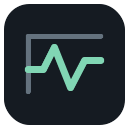

# FrameGauge — 0.8.0 Beta

 · [Русская документация](README_RU.md)

**Performance monitoring for Godot, by PFT Studio.** Free, MIT (publisher approval pending), no paid tier or account required. Godot 4.7.2 is the test target. The previous 0.7.1 build was manually tried on Windows in a real game. The 0.8.0 candidate still needs the checks below before publication.

## Install
Download the **addon ZIP**, not the demo ZIP. Extract it into the folder that contains your game’s `project.godot` (the archive already contains `addons/`). The correct path is `res://addons/pft_benchmark/plugin.cfg`, never `res://addons/addons/pft_benchmark/plugin.cfg`. If manually copying, copy the inner `pft_benchmark` folder into your existing `addons/` folder. Enable **FrameGauge Free** in Project > Project Settings > Plugins. A FrameGauge dock appears and the plugin adds the `PFTBenchmark` autoload. Do not copy the demo's `project.godot` into your game. Disable the plugin before deleting its directory; it removes its own autoload, not an unrelated one.

**Updating PFT Benchmark 0.5.0:** stop the game, close the editor, replace the existing `addons/pft_benchmark` directory with the new one, reopen the editor. The legacy directory, project settings prefix `pft_benchmark/`, autoload name, debug message prefix and local appearance filename are intentionally unchanged. Your own game's configuration should carry over. The renamed standalone demo may get a new Godot user data directory, so its locally saved style may need to be recreated. Back up your project first.

## Use
- F9: show/hide; Shift+F9: cycle layouts; Ctrl+F9: reset stats; Alt+left drag: move HUD; Ctrl+Shift+F9: return to corner. Alt+F9 (default) opens the complete settings menu; configurable in Controls. Esc cancels uncommitted changes. Drag position lasts until restart.
- Setup: runtime enable, startup visibility, optional editor telemetry, release export opt-in. Style: layout, corner, HUD language, size (40–200%), background opacity (0–100%), whole HUD opacity (35–100%), accent color, refresh and history size. The preview uses illustrative values. Metrics: 24 independent switches and Minimal/Standard/Full presets; individual editing selects Custom. Live: latest active reporting debug session.
- Apply & save, then restart the running game. In-game appearance adjustments preview instantly; Save & close writes `user://pft_benchmark_appearance.cfg`, which overrides project HUD, metrics, shortcut and sampling defaults; Project defaults previews the project values and saving commits them. Runtime menu does not pause gameplay. HUD language is EN/RU; editor and demo remain mainly English.
- Debug builds by default; release exports and headless do not show a HUD by default. Optional telemetry uses the Godot editor debugger only, not an external service, and stops when HUD is hidden.

## What the numbers mean
Frame time is a monotonic interval between process callbacks, not GPU time. FPS is the engine's FPS counter. Average FPS = frames / elapsed interval; rolling 1% low = reciprocal of the mean of the slowest ceil(1%) frame intervals (minimum 100 frames); default window 600 frames. Graph uses the configured recent sample count. Min/max and >33.333 ms spikes are rolling. CPU process/physics times are engine monitors; optional CPU/GPU render time refers to the root viewport. Unsupported timing is N/A. Enable render timing only if no other profiler owns viewport timing. Engine static memory and rendering video memory are engine estimates, not whole-process RAM or total VRAM. Host free/total RAM is OS physical memory; Linux CPU busy and a single readable DRM GPU busy counter are experimental host metrics, not per-game utilization. Windows CPU/GPU percentages, clocks and temperatures are not implemented. Draw calls, primitives and render objects are engine-wide; primitives do not always mean triangles. HUD update CPU is synchronous update cost only, not full overhead.

## Demo and tests (full project archive)
Import `project.godot` with Godot 4.7 and F5. Select Low/Medium/High/Extreme or set 0–1024 rigid bodies and 0–1600 render-only meshes independently. Reset, Blast, shadows and orbit controls are available. Bodies may sleep. The 2D demo is `demo/main.tscn` (F6).
- Enable Uncap FPS before A/B. The A/B test freezes bodies and camera, warms up for 2 seconds per condition and measures for 5 seconds each, HUD off then on. Repeat under identical conditions. Disable telemetry and render timing for HUD-only measurement. Driver limits, thermals, order and background tasks affect results.
- The 60-second workload test has a 3-second warm-up, periodic impulses, a stationary camera, average FPS, full-run 1% low (N/A beyond 200,000 samples), and slow-frame count. It is not a deterministic physics benchmark.
- Run `python tools/validate.py` for source/package checks. Run `python tools/validate.py --godot /path/to/godot` for engine import and test scripts; graphical checks still required. See VALIDATION.md and RELEASE_CHECKLIST.md.

## License and disclosure
MIT license text included. Developed with AI-assisted coding and design; no AI-generated runtime data. No network dependency or external native module. Optional editor telemetry is local. All runtime metrics are from engine/OS counters or measured frame intervals. Do not treat unavailable hardware measurements as zero. Public distribution requires publisher approval and engine verification.

## Quick HUD settings (0.8.0)
Click **Settings** in the HUD or **HUD settings / size** in the demo lab. The configured shortcut (Alt+F9 by default) works even if the HUD is hidden, and is useful with a captured mouse. Appearance has layout, corner, size presets (50/75/100%), scale and opacity; Metrics lets you select individual visible counters. Editing metrics selects Custom; explicit layout presets restore their default visible metrics. Save & close persists layout, corner, metrics and appearance locally. Controls lets you capture a new settings shortcut (e.g. Ctrl+Shift+B). Advanced configures refresh rate, statistics and graph windows, graph type and render timing. Apply saves without closing; Save & close saves and closes. Cancel, Esc and × restore the last committed settings. Project defaults previews defaults; save to keep them. Changing the statistics window may discard old samples; cancel does not recover discarded samples. The settings panel does not pause the game.

## Release checks
The full project includes a GitHub Actions workflow for Godot 4.7.2 (Linux and Windows). Run `python tools/validate.py --godot /path/to/godot --gui` on a machine with a display to also check runtime settings and load both demos. The validator works in a temporary copy with a unique project name; it does not overwrite your original project settings. CI is a proposed gate, not evidence that engine tests have passed.

Windows: run `CHECK_WINDOWS.cmd` in the full project and select your Godot 4.7.2 executable (Python 3 required). Attach `FRAMEGAUGE_QA.log` when reporting a failed test.